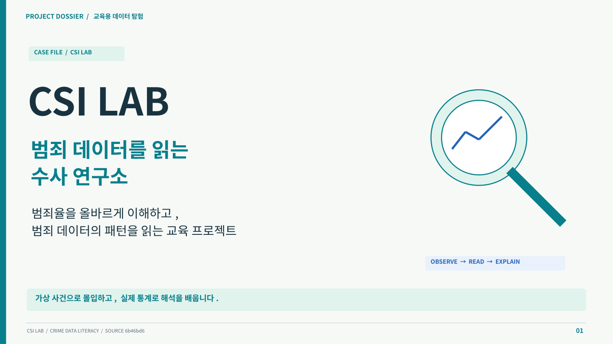

# CSI LAB 발표 자료

범죄율을 올바르게 이해하고 범죄 데이터의 패턴을 읽는 교육 프로젝트를 설명하는 **42장 PPT**입니다. 교육 목적, 사용자 경험, 데이터 범위, 전처리, AI 관찰, 실제 패턴 읽기, 검증과 개선 계획을 연결했습니다.



## 산출물

- [PPTX](CSI_LAB_교육프로젝트_전면개편.pptx): 편집 가능한 텍스트·도형·데이터 차트, 핵심 코드 20곳, 코드 원본 하이퍼링크, 전 슬라이드 발표 노트
- [PDF](CSI_LAB_교육프로젝트_전면개편.pdf): 발표·검토용
- [발표 원고와 근거](발표원고_근거.md): 상세 설명·코드·원본 링크
- [데이터 실측](data_audit.json): 기간·행 수·결측·키 중복·SHA-256
- [기능 검증](validation.json): 대표 CASE의 실제 버튼·입력 기반 AppTest 결과
- [코드 발췌](code_excerpts.json): 슬라이드별 원본 경로·행 번호·내용
- `assets/`: 현재 앱 실행 캡처 2장과 로컬 CPU 추론 이미지

참고 파일 `where_u_go.pptx`는 37장의 구성·설명 밀도·코드 제시 방식을 참고하는 용도로만 사용했습니다. 타 프로젝트의 데이터, 성능, 모델, 기여자 정보를 가져오지 않았습니다. 참고자료 자체는 저장소에 복제하지 않았습니다.

## 확인한 사실과 한계

코드와 원본 데이터 기준 커밋: `6b46bd6cc5cdccb32e78ae2f7283a4b4f9dcfa5f`.

- 지역 최종 CSV: 56,616행, 2011–2024년, 7개 도시, 75개 지역 라벨, 54개 범죄 유형. 전국 전수나 모든 조합의 완전성을 뜻하지 않습니다.
- 지역 최종 CSV 동일 키 중복: 0행. 발생건수 결측: 15,888행. 결측은 0건이 아닙니다.
- CORE 장기 관측: 10개 죄종 × 33년 = 330행. 장기 CSV의 `region` 값은 `범위확인필요`이므로 전국 지표라고 표기하지 않았습니다.
- 용산구 절도: 2011년 1,603건, 2023년 987건, 2024년 1,105건. 발표용 재계산으로 전년 대비 약 +12.0%, 2011년 대비 약 −31.1%입니다.
- 지역 파일명의 1994–2024와 실제 기간이 다릅니다. `src/20_build_final_region_dataset.py`는 파일 루프 밖에서 후속 처리해 마지막 파일만 결과에 반영하는 구조이며, 일부 지역명에 `구`가 중복됩니다. 이번 작업은 문서 개편이며 앱 코드와 CSV는 수정하지 않았습니다.
- 인구 보정 범죄율, 학습 효과, 탐지 정확도, 추리 정답률은 미구현 또는 미측정입니다. 로컬 추론 5개 객체는 단일 프레임 기능 확인입니다.
- 집계 원문의 개별 URL·추출일·지역 범위와 행정구역·분류 변경 이력은 추가 확인이 필요합니다. 파일명 시각을 실제 수집일로 간주하지 않았습니다.

## 검증 범위

`tools/validate_presentation_journey.py`는 실제 AppTest 버튼·텍스트 입력으로 심야의 침입자 CASE를 시작하고, YOLO 분석·증거 수집·목격자·가설 저장·최종 추리 제출을 수행했습니다. `REAL DATA UNLOCKED`와 `SAFETY LAB` 렌더링을 확인했습니다. 전 사건·모든 상태 조합의 검증을 뜻하지 않습니다.

화면 캡처는 현재 앱의 다크 테마입니다. 이번 작업의 밝은 디자인은 PPT에 적용했고, 앱 테마는 변경하지 않았습니다.

## 재생성

저장소 루트에서 실행합니다. 발표 생성은 `python-pptx`, `pandas`, `Pillow`, `Pygments`가 필요합니다. 문서 생성 의존성은 앱 `requirements.txt`에 추가하지 않았습니다. 한글 폰트는 Noto Sans CJK KR를 사용했습니다. 해당 폰트가 없는 환경에서는 대체 폰트로 줄바꿈이 달라질 수 있습니다.

```bash
python tools/build_presentation.py
soffice --headless --convert-to pdf --outdir docs/presentation docs/presentation/CSI_LAB_교육프로젝트_전면개편.pptx
```

현재 자료의 실측 근거는 JSON과 소스 커밋에 고정돼 있습니다. 코드가 변경되면 발췌 행 번호·설명·차트의 근거를 검토한 뒤 재생성해야 합니다. 현재 제작 도구는 모든 표시 코드 조각이 완결된 Python 문법인지 검사합니다.

데이터를 다시 실측하려면 다음 명령을 사용합니다. JSON은 현재 HEAD를 근거로 갱신하므로, 과거 발표의 근거를 보존하려면 기존 파일을 먼저 보관해야 합니다. 원본 CSV를 재생성하지는 않습니다.

```bash
python tools/audit_presentation_data.py
```

앱 환경에서 대표 사용자 경로를 재검증하려면:

```bash
YOLO_CONFIG_DIR=/workspace/csi-lab-runtime/yolo \
MPLCONFIGDIR=/workspace/csi-lab-runtime/matplotlib \
OMP_NUM_THREADS=2 .venv/bin/python tools/validate_presentation_journey.py
```

Google Drive 업로드에는 별도로 연결된 Drive 도구 또는 인증된 업로드 경로가 필요합니다. 로컬 파일과 GitHub 반영은 Drive 업로드를 의미하지 않습니다.
